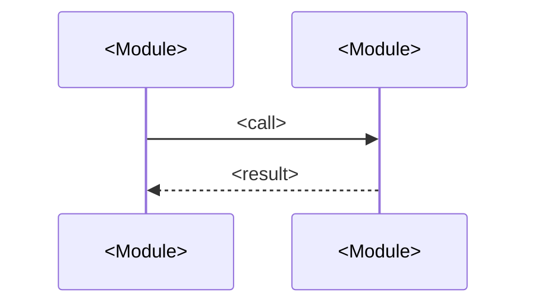

# Design note template

Write `docs/design/<feature>.md` with these sections, in this order. Leave out a section that has no content, except **Interface freeze**, which every note keeps. Use `GLOSSARY.md` terms throughout.

````markdown
# Design: <feature>

## Interface freeze

The interfaces in this note are agreed. An implementing agent that needs to change one stops and asks the user before changing it, and updates this note once the change is approved. Everything behind the interfaces is the agent's to decide.

## Capabilities

- <one line per thing the code must do>

## Reuse

| Capability | Module | How it is used | Why |
|---|---|---|---|

Include the exact signatures used, in a code block under the table.

## Extend

Per extended module:

### <Module>

- **Change**: <old signature → new signature>
- **Affected call sites**: <list>
- **Why extend instead of adding a new module**: <reason>

## New

Per new module:

### <Module>

- **Purpose**: <the user's purpose sentence>
- **Hides**: <the knowledge or decision behind its seam>
- **Talks to**: <modules>
- **Interface**: signatures in a code block (or pseudo-signatures for greenfield), with invariants, ordering constraints and error modes
- **Alternatives considered**: <one line each, only for modules that went through design-it-twice>

## Flows

Per main path, a Mermaid sequence diagram with one participant per module:



## Errors

| Interface | Error mode | Decision | Reason |
|---|---|---|---|

Decision is one of: defined out of existence, masked, aggregated, passed to caller.

## Test seams

| Interface | What a test here catches | What it misses |
|---|---|---|

## Related

- Prototype branch: <name, if any>
- ADRs: <links, if any>
````
